# Docker Stack App Ideas

**Stack:** Mailpit · Memos · n8n · ntfy · PocketBase · FileBrowser

- **PocketBase** → database, auth, REST/realtime API (source of truth)
- **n8n** → automation, glue, scheduling, integrations
- **ntfy** → push notifications
- **Mailpit** → email testing / SMTP capture
- **FileBrowser** → file storage, uploads, deliverables
- **Memos** → quick capture, notes, scratchpad

---

## Part 1 — 10 Personal / Developer App Ideas

### 1. Personal CRM with Auto-Enrichment

PocketBase stores contacts; n8n enriches them from GitHub, LinkedIn, and company sites; ntfy pings you for follow-ups; Memos logs quick call notes; Mailpit catches outbound drip emails during development.

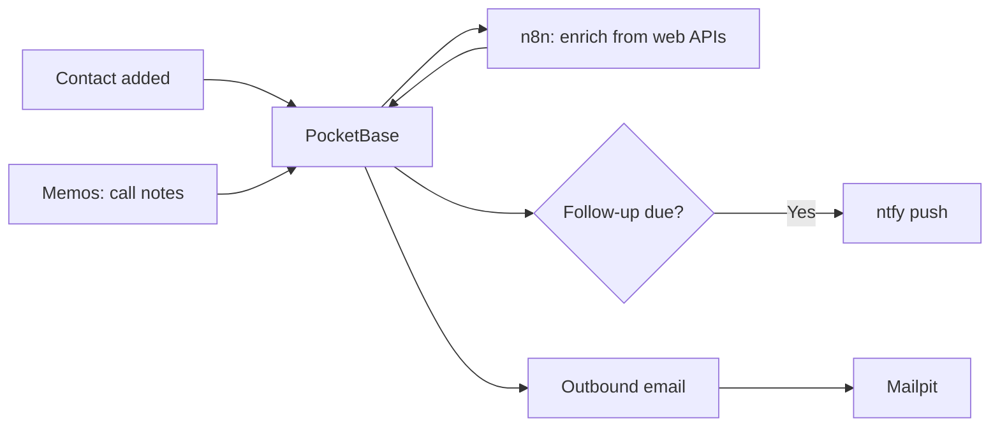

---

### 2. Uptime & Error Monitor with Escalation

n8n pings your sites and services on a schedule, logs results to PocketBase, and escalates outages through ntfy and email. FileBrowser archives logs.

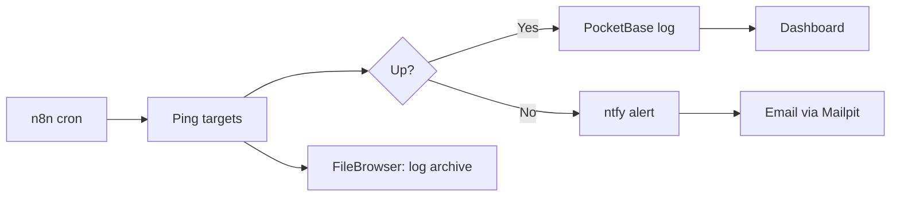

---

### 3. Client Portal / Project Handoff System

PocketBase holds clients, projects, and invoices. FileBrowser is the deliverable vault. n8n generates invoices and reminders, while Memos acts as an internal scratchpad.

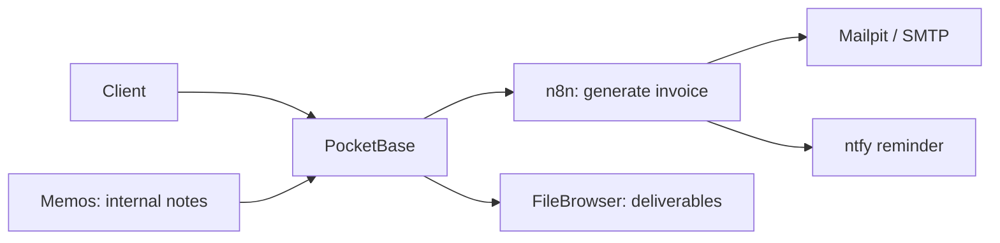

---

### 4. Content Pipeline / Editorial Calendar

Memos captures ideas, n8n promotes them into PocketBase drafts, schedules publishing, and reminds you via ntfy. FileBrowser holds media assets, Mailpit previews newsletters.

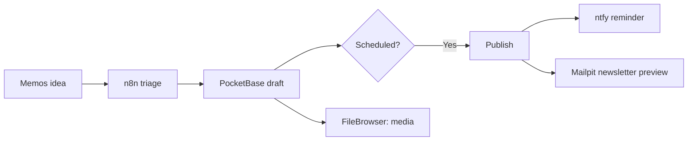

---

### 5. Dev Diary / Changelog Generator

Git webhooks feed n8n, which parses commits into PocketBase entries and publishes a changelog. ntfy notifies subscribers; Memos holds daily dev journaling.

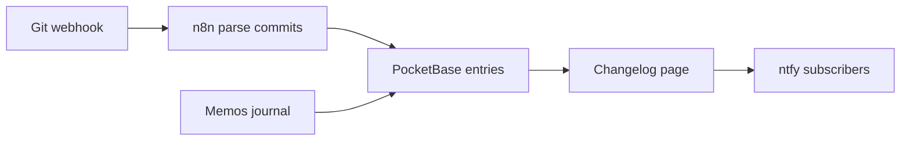

---

### 6. Home / Lab Dashboard & Alert Hub

n8n collects metrics (disk, containers, temps), stores them in PocketBase, pushes threshold alerts via ntfy, and sends weekly digests by email. FileBrowser handles backups.

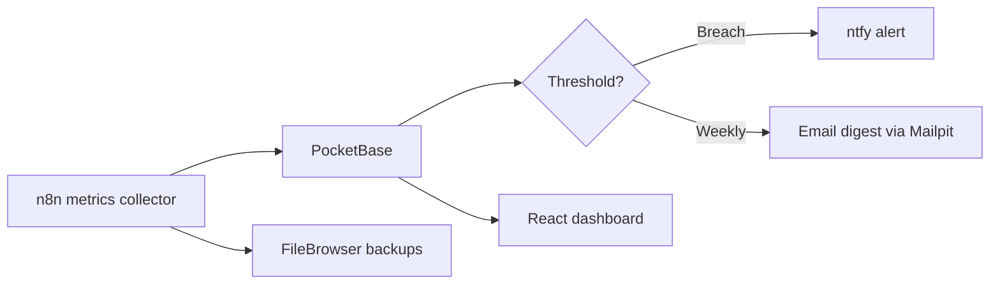

---

### 7. Lead Capture → Nurture Funnel

A landing page posts leads to PocketBase. n8n scores and segments them, sends a drip sequence, and alerts you on hot leads via ntfy. Memos holds sales notes.

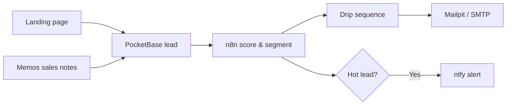

---

### 8. Subscription / SaaS Starter Kit

PocketBase handles auth and billing records. n8n manages trials, dunning, and renewals. ntfy notifies users, Mailpit tests transactional email, and FileBrowser stores uploads.

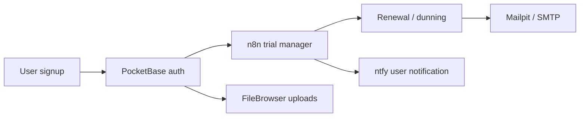

---

### 9. Personal Knowledge Base / Second Brain

Memos captures fleeting notes, n8n tags and links them, PocketBase stores the permanent zettelkasten, and FileBrowser holds attachments. ntfy sends daily review reminders.

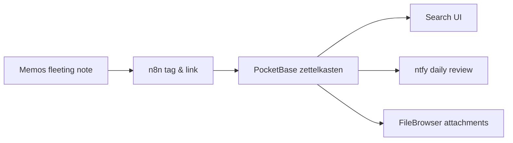

---

### 10. Webhook Router / Integration Hub

One endpoint receives events from GitHub, Stripe, forms, or IoT. n8n routes them, PocketBase logs everything, ntfy and email notify, and FileBrowser stores raw payloads for debugging.

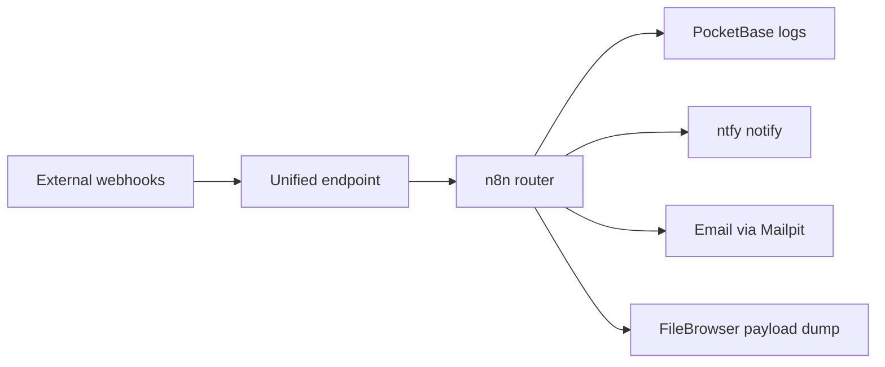

---

## Part 2 — 5 Monetizable Business App Ideas

> Each of these targets a real pain point SMBs, agencies, or dev teams pay for. Your stack gives you a low-cost MVP path and a clean upsell story.

### 1. Client Onboarding & Document Collection Portal

**Pitch:** "Stop chasing clients for documents over email." A branded portal where clients upload IDs, contracts, and tax forms, sign off on steps, and get automatic reminders.

**Who pays:** Accountants, law firms, agencies, mortgage brokers.

**Monetization:** Per-client monthly fee ($29–$99/mo), or per-seat for the firm.

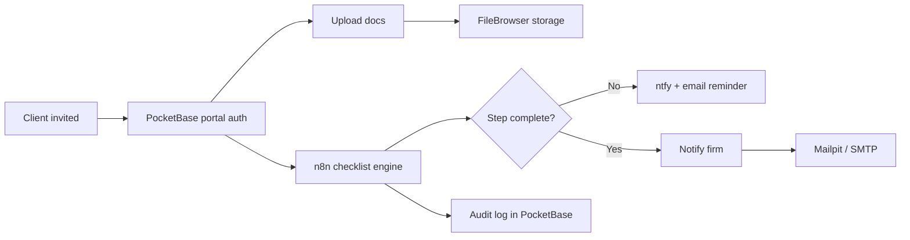

---

### 2. Website Monitoring & Client Reporting SaaS

**Pitch:** "We watch your site 24/7 and send you a plain-English monthly report." Uptime, SSL expiry, broken links, speed, and form submissions, all delivered automatically.

**Who pays:** Web agencies, freelancers reselling to clients, SMBs with no IT.

**Monetization:** $9–$49 per site per month, white-labeled for agencies.

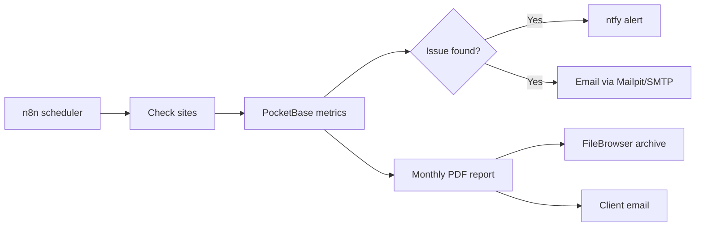

---

### 3. Automated Invoice & Dunning Service

**Pitch:** "Get paid faster without awkward follow-ups." Generates invoices, sends polite reminders on a schedule, escalates tone, and logs every touchpoint.

**Who pays:** Freelancers, small agencies, consultants, SaaS founders.

**Monetization:** $19–$79/mo, or % of recovered revenue.

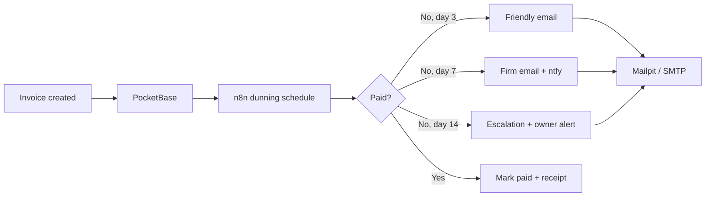

---

### 4. Lead Magnet & Nurture Funnel Service

**Pitch:** "Turn your landing page traffic into booked calls." Captures leads, scores them, sends a personalized drip sequence, and pings the owner when a hot lead arrives.

**Who pays:** Coaches, consultants, real estate agents, B2B service firms.

**Monetization:** $99–$499/mo setup + retainer, or performance-based.

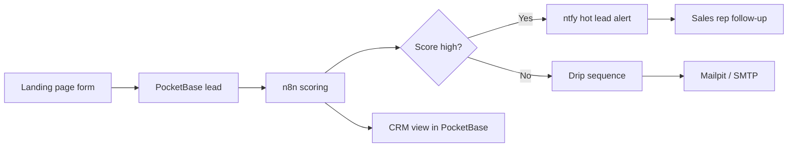

---

### 5. Internal Ops Automation Retainer

**Pitch:** "We replace your spreadsheet chaos with automated workflows." A monthly service that builds and maintains n8n workflows for reporting, alerts, file routing, and approvals, backed by PocketBase and FileBrowser.

**Who pays:** SMBs, clinics, logistics firms, real estate offices, any team with repetitive ops.

**Monetization:** $500–$3,000/mo retainer, plus setup fee.

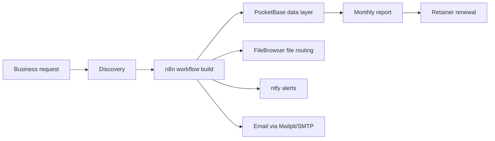

---

## Quick Reference Matrix

| # | Idea | Primary Tools | Personal / Business | Monetizable |
|---|------|---------------|---------------------|-------------|
| 1 | Personal CRM | PB, n8n, ntfy, Memos, Mailpit | Personal | Optional |
| 2 | Uptime Monitor | n8n, PB, ntfy, Mailpit, FB | Personal | Yes |
| 3 | Client Portal | PB, FB, n8n, Memos | Personal | Yes |
| 4 | Content Pipeline | Memos, n8n, PB, FB, Mailpit | Personal | Optional |
| 5 | Changelog Generator | n8n, PB, ntfy, Memos | Personal | Optional |
| 6 | Lab Dashboard | n8n, PB, ntfy, FB, Mailpit | Personal | Optional |
| 7 | Lead Funnel | PB, n8n, Mailpit, ntfy, Memos | Personal | Yes |
| 8 | SaaS Starter Kit | PB, n8n, ntfy, Mailpit, FB | Personal | Yes |
| 9 | Second Brain | Memos, n8n, PB, FB, ntfy | Personal | No |
| 10 | Webhook Hub | n8n, PB, ntfy, Mailpit, FB | Personal | Yes |
| B1 | Onboarding Portal | PB, FB, n8n, ntfy, Mailpit | Business | Yes |
| B2 | Monitoring SaaS | n8n, PB, ntfy, Mailpit, FB | Business | Yes |
| B3 | Dunning Service | PB, n8n, Mailpit, ntfy | Business | Yes |
| B4 | Lead Funnel Service | PB, n8n, Mailpit, ntfy | Business | Yes |
| B5 | Ops Retainer | n8n, PB, FB, ntfy, Mailpit | Business | Yes |

---

*Legend: PB = PocketBase · n8n = automation · ntfy = push · Mailpit = email testing · FB = FileBrowser · Memos = notes*